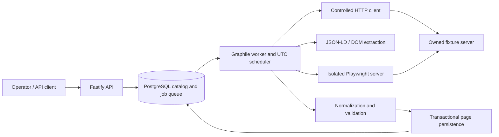

# Architecture

The application is a modular monolith with separate API and worker entry points. They share validated source configuration and PostgreSQL. Graphile Worker stores durable jobs in PostgreSQL, avoiding a second datastore or message broker.

The diagram shows process responsibilities and data flow. Browser network membership is narrower than worker membership; it does not have a direct database/API connection.

## Components

| Location                                       | Responsibility                                                |
| ---------------------------------------------- | ------------------------------------------------------------- |
| `src/entrypoints/`                             | API, worker, migrator, and fixture processes                  |
| `src/config/` and `config/sources.json`        | Environment and trusted source validation                     |
| `src/modules/api/`                             | REST reads, bearer-protected triggers, Swagger, pagination    |
| `src/modules/jobs/`                            | Atomic run/job creation and UTC scheduling                    |
| `src/modules/ingestion/`                       | Attempt lifecycle, extraction coordination, page resumption   |
| `src/modules/network/`                         | URL/DNS policy, pinned connections, pacing, bounded downloads |
| `src/modules/extraction/` and `normalization/` | Candidate extraction, bounded HTML, normalized offers         |
| `src/modules/catalog/`                         | Catalog upserts, current offers, change history               |
| `src/shared/`                                  | Database transactions, runtime grants, logging, errors        |

Both API and worker initialize the source registry at startup, so a ready API can queue a run before the worker starts. The API never fetches a client-supplied URL. Each run saves its source configuration snapshot/hash for reproducibility.

## Ingestion lifecycle

1. A manual trigger or scheduled occurrence creates a run and Graphile job in one transaction. Source-row locking and an active-source unique index prevent overlap; optional idempotency keys reuse previous manual runs.
2. The worker starts an attempt, uses the deadline saved when the run was created, and loads completed page results. Previously committed pages are skipped; saved next links allow resumption.
3. Controlled HTTP fetch validates origin/path, DNS destinations, redirects, bytes, and time. JSON-LD has precedence; matching DOM candidates can supply missing or invalid fields. Identity matching uses listing keys, not array positions. Offers may carry a JSON-LD SKU variant or use a default variant; aggregate price ranges are unsupported.
4. If static extraction yields no valid offers or rejected candidates, explicitly enabled fixture-only Playwright rendering is attempted. Rendered HTML passes through extraction and normalization again. HTTP denial and policy errors end the attempt; they do not activate browser fallback.
5. A page transaction persists valid offers and its result. Validated pagination stays within page/item/deadline bounds. Terminal status is `succeeded`, `partial`, or `failed`; partial means useful work was committed despite rejected or incomplete data.

## Catalog and history

Application tables separate sources, runs, attempts, and page results from products, variants, current offers, and append-only offer history. Graphile owns its queue schema. Product detail exposes variant offers; history is queried separately.

Products/variants have source-specific stable keys and unique constraints. Prices use `numeric(20,6)` and decimal strings at the API boundary. Each page transaction locks the run, upserts records, compares current price/currency/availability, appends history only when that tuple differs, updates observation timestamps, and commits page counters/results. Returning to an earlier tuple is a new change. Replaying a completed page is a no-op.

Each persistence statement receives a timeout capped by the remaining run budget and 15 seconds. An expired page rolls back; earlier committed pages remain available. Invalid records do not erase previous state, and missing listings do not imply out of stock. Staleness is visible through observation timestamps. Run detail uses a read-only repeatable-read transaction to keep attempts/pages consistent during worker transitions.

## Jobs and recovery

One worker instance holds an advisory lock and runs at global concurrency two. Per-source Graphile queues serialize source work; the worker shares one BrowserExtractor instance with one extraction slot. Expected transient errors persist attempt/backoff state and enqueue a future job, using exponential jitter and Retry-After rather than sleeping in the worker. The expected-error retry path permits up to four ingestion attempts, subject to the deadline. Each queued ingestion task has Graphile `max_attempts=3` for infrastructure failures. Configured run budgets cannot exceed ten minutes; these are separate bounds, not a guarantee of exactly four executions under infrastructure failure.

The scheduler ticks once per minute and uses the latest UTC occurrence, with at most one catch-up occurrence per source after downtime. Scheduled-occurrence uniqueness prevents duplicate enqueue. Deadline reconciliation finalizes exhausted/stale work. Graphile crash-lock recovery can outlast normal retries; immediate recovery is not promised. Graceful worker shutdown releases its advisory lock and database resources.

## Browser and operational boundaries

Browser GET resources are intercepted and fulfilled through the controlled HTTP client, with allowed methods/types, request count, cumulative bytes, and a shared time budget. Fresh contexts block service workers, WebSockets, popups, and download acceptance. HTML/JSON-LD parsing and normalized strings are bounded before persistence.

Compose puts the sandboxed Playwright server on fixture/control networks, separate from API/database networks. Internal bridges remove host gateways in the tested IPv4 configuration. Native browser traffic is not fully governed by interception; network isolation is an additional boundary. Host-launched browsers do not inherit it. See [security](security.md).

Migrations use the database owner; API/worker use a separate non-superuser operational role. Pino logs omit raw HTML/configuration and redact sensitive fields. Health checks cover process/database/schema readiness, fixture liveness, browser listener, and worker advisory-lock ownership; they do not measure job progress. [Operations](operations.md) describes startup gates, restart, and recovery. [Source policy](source-policy.md) defines supported sources; detailed tests remain in the [verification archive](verification/README.md).
